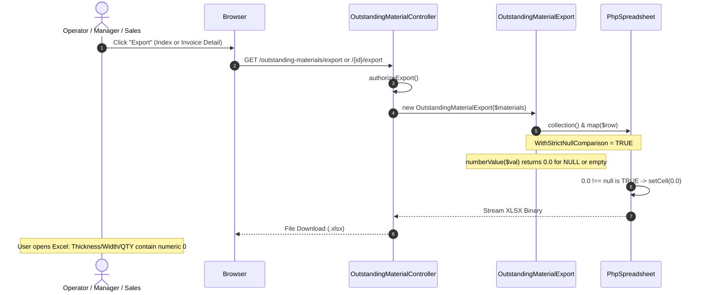
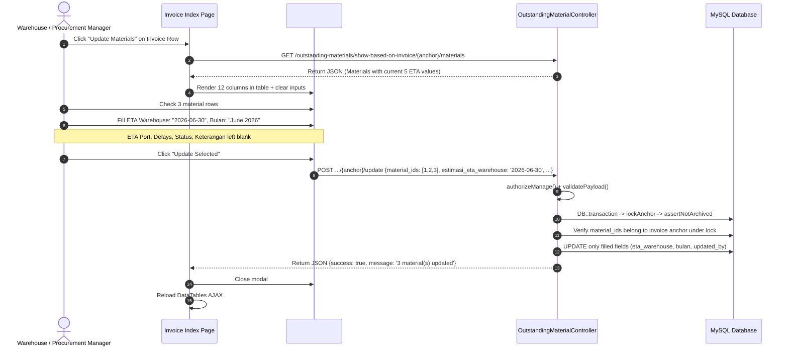
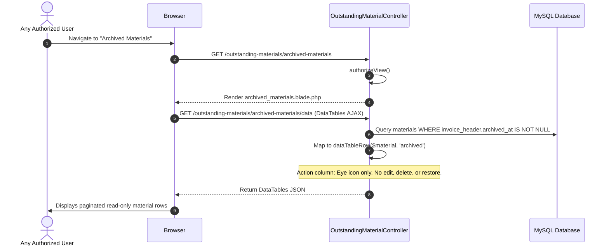

# GATE 1 — TECHNICAL IMPLEMENTATION & AUDIT PLAN
# Outstanding Material: Additional Revisions (Excel Zero Handling, Bulk ETA Update & Archived Materials)

**Project:** Fastware ADSI  
**Repository:** `poyipoy/fastware_adsi_1`  
**Module:** Outstanding Material  
**Technology Stack:** Laravel 10.10, PHP 8.2+, MySQL 8.0, Maatwebsite Excel 3.1.55, PhpSpreadsheet 1.29.0, Blade, Bootstrap 5.3.2, jQuery, DataTables (Server-Side)  
**Execution Mode:** READ-ONLY REPOSITORY AUDIT + GATE 1 PLANNING  
**Document Status:** `COMPLETED GATE 1 PLAN — PENDING USER APPROVAL FOR GATE 2`  
**Delivery Path:** `docs/outstanding-materials/GATE-1-ADDITIONAL-REVISIONS-EXPORT-ETA-ARCHIVED-MATERIALS.md`  
**Date:** 2026-10-27  

---

## TABLE OF CONTENTS

1. [Executive Summary](#1-executive-summary)
2. [Confirmed User Requirements](#2-confirmed-user-requirements)
3. [Current Repository Audit Findings](#3-current-repository-audit-findings)
4. [Existing vs Target User Flows](#4-existing-vs-target-user-flows)
5. [Revision A — Excel Export Design](#5-revision-a--excel-export-design)
6. [Revision B — Bulk ETA Update Design](#6-revision-b--bulk-eta-update-design)
7. [Revision C — Archived Materials Design](#7-revision-c--archived-materials-design)
8. [API, Query, Validation & Authorization Contracts](#8-api-query-validation--authorization-contracts)
9. [Exact Affected Files Matrix](#9-exact-affected-files-matrix)
10. [Regression & Automated Testing Plan](#10-regression--automated-testing-plan)
11. [Risks, Dependencies & Compatibility Checks](#11-risks-dependencies--compatibility-checks)
12. [Minimal Gate 2 Implementation Plan](#12-minimal-gate-2-implementation-plan)
13. [Acceptance Criteria](#13-acceptance-criteria)
14. [Gate 2 Readiness Recommendation](#14-gate-2-readiness-recommendation)

---

## 1. EXECUTIVE SUMMARY

This document establishes the technical audit findings, architectural design, and minimal implementation strategy for three additional confirmed revisions to the **Outstanding Material** module of `fastware_adsi_1`:

1. **Revision A — Numeric Zero Handling in Excel Exports:** Apply consistent numeric cell export behavior across both the active Material Index export (`/outstanding-materials/export`) and the scoped Invoice Detail export (`/outstanding-materials/{id}/export`). Numeric columns (`thickness`, `width`, `diameter`, `qty_pcs`, `est_qty_kg`) with value `0`, `NULL`, or empty string will export as numeric `0.0` with explicit `TYPE_NUMERIC` cell binding. Nonzero numerics, text (`length`), and date fields remain strictly unchanged, and zero database mutations occur.
2. **Revision B — Bulk Update Materials Modal with Five ETA Fields:** Extend the existing `#invoiceUpdateModal` in `resources/views/outstanding_materials/invoice.blade.php` and its controller endpoint `updateInvoiceFieldsForAnchor()`. The modal's selection table is expanded to display the five current ETA columns (`estimasi_eta_port`, `estimasi_eta_warehouse`, `estimasi_bulan_eta`, `estimasi_delay_eta_port`, `estimasi_delay_eta_warehouse`), and five corresponding input controls are added beneath the table alongside Status and Keterangan. Omitted or empty fields strictly follow "keep current" semantics; transactional multi-row updates verify invoice group ownership; and archived invoices remain mutation-protected.
3. **Revision C — Dedicated Archived Materials Page:** Create a dedicated, read-only **Archived Materials** page (`/outstanding-materials/archived-materials`) that lists material rows belonging to invoices previously archived via the existing invoice-level archive feature. The architecture strictly reuses the authoritative invoice-header `archived_at` marker without adding per-material archive lifecycles, database migrations, or per-material restore actions. When an invoice is restored, its materials automatically return to the active Material Index.

### Compliance Declaration

- **Zero application code, database migrations, models, controllers, views, or assets have been modified during Gate 1.**
- **Zero mutating commands, seeders, or database migrations have been executed.**
- **Repository evidence has been gathered via read-only inspections of local source code, vendor code, and configuration.**
- **All implementation work is held until explicit user authorization for Gate 2 is granted.**

---

## 2. CONFIRMED USER REQUIREMENTS

### 2.1 Revision A: Numeric Zero Handling in Excel Exports

| Requirement ID | Specification | Details |
|---|---|---|
| **REQ-A1** | Dual Export Parity | Applies identically to **Material Index Export** (`outstanding-materials.export`) and **Invoice Detail Export** (`outstanding-materials.invoice-detail.export`). |
| **REQ-A2** | Numeric Zero Output | Database numeric values that are `NULL` or empty string must export as numeric `0` (`0.0`). |
| **REQ-A3** | Existing Zero Preservation | Database numeric values that are already `0` or `0.00` must export as numeric `0` (`0.0`). |
| **REQ-A4** | Nonzero Value Preservation | Valid nonzero numeric values (e.g. `12.50`, `1500`, `2500`) must remain exact floats. |
| **REQ-A5** | Target Numeric Fields | Strictly applies to: `thickness`, `width`, `diameter`, `qty_pcs`, `est_qty_kg`. |
| **REQ-A6** | Field Exclusions | Column `length` is defined as `VARCHAR` in the database schema and must remain text/null. All date and text columns preserve existing behavior. |
| **REQ-A7** | No Database Mutation | Zero database records may be updated, converted, or backfilled. Changes occur purely in the export mapping layer. |
| **REQ-A8** | Numeric Cell Typing | Exported XLSX cells must be formatted as genuine numeric values, not string `"0"`. |

### 2.2 Revision B: Bulk Update Materials with Five ETA Fields

| Requirement ID | Specification | Details |
|---|---|---|
| **REQ-B1** | Workflow Reuse | Extend the existing `#invoiceUpdateModal` in `resources/views/outstanding_materials/invoice.blade.php`; do not build a separate ETA editing workflow. |
| **REQ-B2** | Table Column Visibility | Add 5 ETA columns to the selection table in the modal so operators see current values before updating: `ETA Port`, `ETA Warehouse`, `Bulan ETA`, `Delay ETA Port`, `Delay ETA Warehouse`. |
| **REQ-B3** | Five Update Controls | Add five update controls beneath the table corresponding to the five ETA fields, placed cleanly alongside Status and Keterangan. |
| **REQ-B4** | Field Preservation (Keep Current) | Omitted or blank update controls mean **KEEP CURRENT**. An untouched field must never overwrite existing material data with `NULL` or empty string. |
| **REQ-B5** | Minimum Update Constraint | A valid submission must include at least one field update across Status, Keterangan, or the 5 ETA fields. Submitting without any field selected or entered is rejected. |
| **REQ-B6** | Scope & Ownership Protection | Only selected material IDs are modified. Every submitted ID must belong to the authoritative invoice group anchored by the URL parameter. Cross-invoice manipulation is rejected. |
| **REQ-B7** | Date Validation | Submitted dates must be validated calendar dates (`YYYY-MM-DD`). Calendar-impossible dates (e.g. `2026-02-30`) are rejected before SQL execution. |
| **REQ-B8** | Month Convention | `estimasi_bulan_eta` accepts standard human-readable month strings matching existing project convention (e.g. `"May 2026"`), validated as `nullable|string|max:255`. |
| **REQ-B9** | Archive Guard | If the invoice is archived, updates must be rejected with HTTP 422 under lock. |
| **REQ-B10** | Transactional Atomicity | Multi-material updates execute in a single database transaction under `lockForUpdate()`. |

### 2.3 Revision C: Dedicated Archived Materials Page

| Requirement ID | Specification | Details |
|---|---|---|
| **REQ-C1** | Dedicated View | Provide a dedicated view `/outstanding-materials/archived-materials` (`outstanding-materials.materials.archived.index`). |
| **REQ-C2** | Invoice Header Hierarchy | Archive status strictly follows the authoritative parent invoice header (`outstanding_material_invoices.archived_at IS NOT NULL`). |
| **REQ-C3** | No Per-Material Architecture | Zero per-material archive columns, zero per-material archive buttons, and zero separate material archive lifecycles. |
| **REQ-C4** | Zero Schema Migrations | Reuses existing invoice `archived_at` column; no new tables or migrations. |
| **REQ-C5** | Read-Only Surface | Strictly read-only: no Add, Edit, Delete, Import, Bulk Update, or per-material Restore buttons. Only Detail view and document downloads (if authorized) are exposed. |
| **REQ-C6** | Dynamic Restoration Transition | When an invoice is restored via the existing Invoice Archive feature, all its materials automatically disappear from Archived Materials and reappear in the active Material Index. |
| **REQ-C7** | Server-Side DataTables | Server-side pagination, search, column ordering, and filters matching the familiar Material Index UI. |
| **REQ-C8** | Supplier & Invoice Isolation | Materials display their invoice number and supplier, with canonical identity isolation between duplicate invoice numbers from different vendors. |
| **REQ-C9** | Document Download Permissions | Packing List and MTC downloads are permitted only if the user satisfies `canDownloadInvoiceDocuments`. |
| **REQ-C10** | Clear Navigation | Breadcrumbs and action buttons link smoothly to Active Material Index (`/outstanding-materials`), Active Invoices (`/outstanding-materials/show-based-on-invoice`), and Archived Invoices (`/outstanding-materials/archived-invoices`). |

---

## 3. CURRENT REPOSITORY AUDIT FINDINGS

### 3.1 Git Working Tree & Local Baseline

- **Current Branch:** `main`  
- **Commit HEAD:** `6161d68` (`feat(warehouse): enhance warehouse workflow, multi-machine tracking, and outstanding materials`)  
- **Uncommitted Local Modifications:**
  - `app/Exports/OutstandingMaterialExport.php` (unmodified on HEAD, clean baseline)
  - `app/Http/Controllers/OutstandingMaterialController.php` (uncommitted additions for invoice archive and preliminary tests)
  - `app/Models/OutstandingMaterial.php` (uncommitted casts and scopes)
  - `app/Services/OutstandingMaterialInvoiceService.php` (uncommitted archive invoice methods)
  - `resources/views/outstanding_materials/invoice.blade.php` (uncommitted invoice archive modal hooks)
  - `database/migrations/2026_10_15_000001_add_archived_at_to_outstanding_material_invoices_table.php` (untracked minimal DDL)
  - `database/migrations/2026_10_15_000002_add_archived_at_to_outstanding_materials_table.php` (untracked draft migration from prior experiment)
  - `resources/views/outstanding_materials/archived_invoices.blade.php` (untracked view from completed invoice archive mission)
  - Multiple feature tests in `tests/Feature/OutstandingMaterial*.php`

**Audited Fact:** The local working tree already contains completed Gate 2 implementations for Invoice Archive (`archived_at` on headers) and ETA Priority Sorting. However, an uncommitted draft migration (`...000002_add_archived_at_to_outstanding_materials_table.php`) attempted per-material `archived_at` columns. **The user's confirmed requirement for Revision C explicitly overrides that direction:** Revision C strictly uses the **invoice-level `archived_at` marker** and forbids per-material archive lifecycles or new migrations.

---

### 3.2 Revision A Audit — Excel Export Engine Mechanics

#### File: `app/Exports/OutstandingMaterialExport.php`
- Class declaration:
  ```php
  class OutstandingMaterialExport implements FromCollection, WithColumnWidths, WithHeadings, WithMapping, WithStyles
  ```
- Current `numberValue()` method (lines 173–176):
  ```php
  private function numberValue(mixed $value): mixed
  {
      return $value === null ? null : (float) $value;
  }
  ```
- Current `map()` method (lines 68–73):
  ```php
  $this->numberValue($material->thickness),
  $this->numberValue($material->width),
  $this->numberValue($material->diameter),
  $material->length,
  $this->numberValue($material->qty_pcs),
  $this->numberValue($material->est_qty_kg),
  ```

#### Deep Technical Root Cause: Loose Null Comparison in PhpSpreadsheet
1. In `vendor/phpoffice/phpspreadsheet/src/PhpSpreadsheet/Worksheet/Worksheet.php`, the `fromArray()` method implements:
   ```php
   if ($strictNullComparison) {
       if ($cellValue !== $nullValue) {
           $this->getCell($currentColumn . $startRow)->setValue($cellValue);
       }
   } else {
       if ($cellValue != $nullValue) {
           $this->getCell($currentColumn . $startRow)->setValue($cellValue);
       }
   }
   ```
2. When `$strictNullComparison` is `false`:
   - In PHP: `0.0 == null` evaluates to `true`! Therefore `0.0 != null` evaluates to `false`!
   - Because `0.0 != null` is false, PhpSpreadsheet **skips setting the cell value**. The cell remains completely empty in the resulting Excel workbook.
3. In `vendor/maatwebsite/excel/src/Sheet.php`, `hasStrictNullComparison($sheetExport)` checks:
   ```php
   if ($sheetExport instanceof WithStrictNullComparison) {
       return true;
   }
   return config('excel.exports.strict_null_comparison', false);
   ```
4. In `config/excel.php` (line 34):
   ```php
   'strict_null_comparison' => false,
   ```
   Global strict comparison is disabled by default.
5. `OutstandingMaterialExport` does **NOT** currently implement `Maatwebsite\Excel\Concerns\WithStrictNullComparison`.
6. **Decisive Architectural Finding:**
   - To guarantee that numeric `0` or `0.0` is written into the Excel cell rather than skipped by PhpSpreadsheet, `OutstandingMaterialExport` **MUST implement `WithStrictNullComparison`**.
   - `numberValue($value)` must return `(float) 0.0` when input is `null`, `''`, or `0`.
   - When `$strictNullComparison` is active:
     - `$cellValue = 0.0` → `0.0 !== null` is `true` → cell value is explicitly set to `0.0`.
     - `DefaultValueBinder` detects PHP `float` → writes cell type as `DataType::TYPE_NUMERIC`.
     - For non-numeric nullable columns (e.g. dates, length, remarks), `$cellValue = null` → `null !== null` is `false` → cell remains empty, perfectly preserving existing behavior.

---

### 3.3 Revision B Audit — Modal & Controller Endpoints

#### File: `resources/views/outstanding_materials/invoice.blade.php`
- Current modal table markup (lines 33):
  ```html
  <table class="table table-sm table-bordered">
      <thead class="table-light">
          <tr>
              <th></th><th>Supplier</th><th>Type</th><th>Dimensions</th><th>QTY</th><th>Status</th><th>Keterangan</th>
          </tr>
      </thead>
      <tbody id="modalMaterialsBody"></tbody>
  </table>
  ```
  Only 7 columns are rendered. Current ETA values are not retrieved or displayed.
- Current update controls (lines 33):
  Only `#modalStatus` and `#modalKeterangan` exist. No ETA controls are present.
- Current client script (`invoice.blade.php` lines 109–122):
  Populates rows from `scopedUrl(anchor, 'materials')`.

#### File: `app/Http/Controllers/OutstandingMaterialController.php`
- Method `invoiceMaterialsForAnchor(OutstandingMaterial $outstandingMaterial)` (lines 964–975):
  ```php
  return response()->json(
      $this->invoiceScope($outstandingMaterial)
          ->unarchived()
          ->select('id', 'supplier', 'type', 'thickness', 'width', 'diameter', 'length', 'qty_pcs', 'est_qty_kg', 'status', 'keterangan')
          ->orderBy('id')
          ->get(),
  );
  ```
  **Finding:** The select clause does not include any of the 5 ETA columns (`estimasi_eta_port`, `estimasi_eta_warehouse`, `estimasi_bulan_eta`, `estimasi_delay_eta_port`, `estimasi_delay_eta_warehouse`).
- Method `updateInvoiceFieldsForAnchor(Request $request, OutstandingMaterial $outstandingMaterial)` (lines 1050–1130):
  Validates only `status` and `keterangan`. If both are empty, throws validation error. Applies updates to selected IDs scoped to `$this->invoiceScope($lockedAnchor)`.
- Method `updateInvoiceFields(Request $request)` (lines 1026–1048):
  Pass-through endpoint that forwards to `updateInvoiceFieldsForAnchor()`.

#### Database Schema & Types for ETA Fields
From `database/migrations/2026_05_22_000001_create_outstanding_materials_table.php` and `2026_05_25_000001_relax_...`:
- `estimasi_eta_port`: `VARCHAR(100) NULL`
- `estimasi_eta_warehouse`: `VARCHAR(100) NULL`
- `estimasi_delay_eta_port`: `VARCHAR(100) NULL`
- `estimasi_delay_eta_warehouse`: `VARCHAR(100) NULL`
- `estimasi_bulan_eta`: `VARCHAR(255) NULL`
- While stored as `VARCHAR` in MySQL, standard form input conventions in `form.blade.php` use `<input type="date">` for the 4 date fields, formatted as `YYYY-MM-DD`.
- `estimasi_bulan_eta` is rendered as `<input type="text" placeholder="Contoh: May 2026">`.
- In `OutstandingMaterialController::sqlValidDate()`, the priority sorting engine specifically validates `YYYY-MM-DD` syntax. Saving validated `YYYY-MM-DD` strings preserves full compatibility with existing sorting rules.

---

### 3.4 Revision C Audit — Dedicated Archived Materials Architecture

#### Database Invariants
- `outstanding_material_invoices.archived_at`: Timestamp marker (NULL = active, timestamp = archived).
- `outstanding_materials`: Contains `invoice_id` foreign key and fallback `invoice_identity_key`.
- In `OutstandingMaterial.php`, the authoritative active query is `scopeUnarchived()`, which checks that the parent invoice header has `archived_at IS NULL`.
- In `OutstandingMaterialController.php`, the active index query is:
  ```php
  OutstandingMaterial::query()->unarchived();
  ```
- **Architectural Fact:** An archived material is simply any material whose associated invoice header is archived:
  ```php
  OutstandingMaterial::query()->whereHas('invoiceHeader', function ($q) {
      $q->whereNotNull('archived_at');
  });
  ```
  With legacy fallback for unlinked rows sharing the canonical `invoice_identity_key`:
  ```php
  ->orWhere(function ($q) {
      $q->whereNull('invoice_id')
        ->whereNotNull('invoice_identity_key')
        ->whereExists(function ($sub) {
            $sub->select(DB::raw(1))
                ->from('outstanding_material_invoices')
                ->whereColumn('outstanding_material_invoices.invoice_identity_key', 'outstanding_materials.invoice_identity_key')
                ->whereNotNull('outstanding_material_invoices.archived_at');
        });
  });
  ```

#### Controller Pattern
- Active Material Index: `index()` (view) + `data()` (JSON for DataTables).
- Archived Invoices: `archivedInvoiceIndex()` + `archivedInvoiceData()`.
- Proposed Archived Materials: `archivedMaterialIndex()` + `archivedMaterialData()`.
- DataTables row formatting can directly reuse `dataTableRow($material, 'archived')`:
  - Detail button is rendered: `<a href="{{ route('outstanding-materials.show', $material) }}">`
  - Edit and Delete buttons are suppressed: `$allowManage = false`.
  - Document download is preserved: `$allowDownload = $this->access->canDownloadInvoiceDocuments(Auth::user())`.
- Zero database mutations, zero new migrations, and 100% adherence to single source of truth.

---

## 4. EXISTING VS TARGET USER FLOWS

### 4.1 Revision A: Export User Flow



### 4.2 Revision B: Bulk ETA Update User Flow



### 4.3 Revision C: Archived Materials User Flow



---

## 5. REVISION A — EXCEL EXPORT DESIGN

### 5.1 Interface & Trait Modifications
In `app/Exports/OutstandingMaterialExport.php`:
1. Add concern:
   ```php
   use Maatwebsite\Excel\Concerns\WithStrictNullComparison;
   ```
2. Update class definition:
   ```php
   class OutstandingMaterialExport implements
       FromCollection,
       WithColumnWidths,
       WithHeadings,
       WithMapping,
       WithStyles,
       WithStrictNullComparison
   ```
3. Update `numberValue()` implementation:
   ```php
   /**
    * Map numeric fields so that NULL, empty string, or 0 values are exported
    * as genuine numeric float 0.0 rather than being dropped by loose null checks.
    */
   private function numberValue(mixed $value): float
   {
       if ($value === null || $value === '' || (is_string($value) && trim($value) === '')) {
           return 0.0;
       }

       return (float) $value;
   }
   ```

### 5.2 Column Mapping Matrix

| Column Header | Database Column | Mapping Expression | Expected Export Type | When DB is NULL / Empty | When DB is 0 | When DB is 15.5 |
|---|---|---|---|---|---|---|
| Thickness | `thickness` | `$this->numberValue($material->thickness)` | `TYPE_NUMERIC` | `0.0` | `0.0` | `15.5` |
| Width | `width` | `$this->numberValue($material->width)` | `TYPE_NUMERIC` | `0.0` | `0.0` | `1500.0` |
| Diameter | `diameter` | `$this->numberValue($material->diameter)` | `TYPE_NUMERIC` | `0.0` | `0.0` | `25.0` |
| Length | `length` | `$material->length` | `TYPE_STRING` / NULL | `null` (empty cell) | `"0"` | `"6000"` |
| QTY (PCS) | `qty_pcs` | `$this->numberValue($material->qty_pcs)` | `TYPE_NUMERIC` | `0.0` | `0.0` | `10.0` |
| Est QTY (KG) | `est_qty_kg` | `$this->numberValue($material->est_qty_kg)` | `TYPE_NUMERIC` | `0.0` | `0.0` | `2500.0` |
| Estimasi ETA Port | `estimasi_eta_port` | `$this->dateValue($material->estimasi_eta_port)` | `TYPE_STRING` / NULL | `null` (empty cell) | N/A | `"15-06-2026"` |
| Remarks | `remarks` | `$material->remarks` | `TYPE_STRING` / NULL | `null` (empty cell) | `"0"` | `"Sample"` |

---

## 6. REVISION B — BULK ETA UPDATE DESIGN

### 6.1 Modal Table Expansion
In `resources/views/outstanding_materials/invoice.blade.php`:
The `#invoiceUpdateModal` table is updated with responsive scrolling and compact typography:
```html
<div class="table-responsive" style="max-height: 420px; overflow-x: auto;">
    <table class="table table-sm table-bordered text-nowrap align-middle">
        <thead class="table-light sticky-top">
            <tr>
                <th style="width: 36px;" class="text-center"></th>
                <th>Supplier</th>
                <th>Type</th>
                <th>Dimensions</th>
                <th>QTY</th>
                <th>Status</th>
                <th>Keterangan</th>
                <th>ETA Port</th>
                <th>ETA Warehouse</th>
                <th>Bulan ETA</th>
                <th>Delay ETA Port</th>
                <th>Delay ETA Warehouse</th>
            </tr>
        </thead>
        <tbody id="modalMaterialsBody"></tbody>
    </table>
</div>
```

### 6.2 Update Controls Grid Layout
Beneath the table, the form provides 7 update controls organized in clean Bootstrap columns:
```html
<div class="card bg-light border-0 p-3 mt-3">
    <div class="fw-semibold text-muted small mb-2">
        <i class="bi bi-pencil-square me-1"></i> Nilai Pembaruan Massal (Kosongkan jika tidak ingin mengubah nilai)
    </div>
    <div class="row g-2">
        <div class="col-md-6">
            <label class="form-label small fw-bold">Update Status</label>
            <select class="form-select form-select-sm" id="modalStatus" name="status">
                <option value="">Keep current (Tidak diubah)</option>
                @foreach ($statusOptions as $option)
                    <option value="{{ $option }}">{{ $option }}</option>
                @endforeach
            </select>
        </div>
        <div class="col-md-6">
            <label class="form-label small fw-bold">Update Keterangan</label>
            <select class="form-select form-select-sm" id="modalKeterangan" name="keterangan">
                <option value="">Keep current (Tidak diubah)</option>
                @foreach ($keteranganOptions as $option)
                    <option value="{{ $option }}">{{ $option }}</option>
                @endforeach
            </select>
        </div>
        <div class="col-md-4">
            <label class="form-label small fw-bold">Update ETA Port</label>
            <input type="date" class="form-control form-control-sm" id="modalEtaPort" name="estimasi_eta_port">
        </div>
        <div class="col-md-4">
            <label class="form-label small fw-bold">Update ETA Warehouse</label>
            <input type="date" class="form-control form-control-sm" id="modalEtaWarehouse" name="estimasi_eta_warehouse">
        </div>
        <div class="col-md-4">
            <label class="form-label small fw-bold">Update Bulan ETA</label>
            <input type="text" class="form-control form-control-sm" id="modalBulanEta" name="estimasi_bulan_eta" placeholder="Contoh: June 2026">
        </div>
        <div class="col-md-6">
            <label class="form-label small fw-bold">Update Delay ETA Port</label>
            <input type="date" class="form-control form-control-sm" id="modalDelayEtaPort" name="estimasi_delay_eta_port">
        </div>
        <div class="col-md-6">
            <label class="form-label small fw-bold">Update Delay ETA Warehouse</label>
            <input type="date" class="form-control form-control-sm" id="modalDelayEtaWarehouse" name="estimasi_delay_eta_warehouse">
        </div>
    </div>
</div>
```

### 6.3 Controller Logic
In `OutstandingMaterialController`:
1. **Extend `invoiceMaterialsForAnchor()` select query:**
   ```php
   public function invoiceMaterialsForAnchor(OutstandingMaterial $outstandingMaterial): JsonResponse
   {
       $this->authorizeManage();

       return response()->json(
           $this->invoiceScope($outstandingMaterial)
               ->unarchived()
               ->select([
                   'id', 'supplier', 'type', 'thickness', 'width', 'diameter', 'length',
                   'qty_pcs', 'est_qty_kg', 'status', 'keterangan',
                   'estimasi_eta_port', 'estimasi_eta_warehouse', 'estimasi_bulan_eta',
                   'estimasi_delay_eta_port', 'estimasi_delay_eta_warehouse',
               ])
               ->orderBy('id')
               ->get(),
       );
   }
   ```
2. **Extend `updateInvoiceFieldsForAnchor()`:**
   ```php
   $data = $request->validate([
       'material_ids' => 'required|array|min:1',
       'material_ids.*' => 'integer|exists:outstanding_materials,id',
       'status' => ['nullable', 'string', Rule::in(OutstandingMaterial::statusOptions())],
       'keterangan' => ['nullable', 'string', Rule::in(OutstandingMaterial::keteranganOptions())],
       'estimasi_eta_port' => ['nullable', 'date'],
       'estimasi_eta_warehouse' => ['nullable', 'date'],
       'estimasi_bulan_eta' => ['nullable', 'string', 'max:255'],
       'estimasi_delay_eta_port' => ['nullable', 'date'],
       'estimasi_delay_eta_warehouse' => ['nullable', 'date'],
       'auto_archive' => ['nullable', 'boolean'],
   ]);

   $materialIds = array_values(array_unique(array_map('intval', $data['material_ids'])));
   $updates = ['updated_by' => Auth::id()];

   foreach ([
       'status', 'keterangan',
       'estimasi_eta_port', 'estimasi_eta_warehouse', 'estimasi_bulan_eta',
       'estimasi_delay_eta_port', 'estimasi_delay_eta_warehouse',
   ] as $field) {
       if (array_key_exists($field, $data) && $data[$field] !== null && trim((string) $data[$field]) !== '') {
           $updates[$field] = $data[$field];
       }
   }

   if (count($updates) === 1) { // Only updated_by is present
       throw ValidationException::withMessages([
           'update_fields' => 'Pilih atau isi setidaknya satu kolom untuk diperbarui.',
       ]);
   }
   ```

---

## 7. REVISION C — ARCHIVED MATERIALS DESIGN

### 7.1 Routes & Controller Endpoints
In `routes/web.php` inside `Route::prefix('outstanding-materials')->name('outstanding-materials.')`:
```php
Route::get('/archived-materials', [OutstandingMaterialController::class, 'archivedMaterialIndex'])
    ->name('materials.archived.index');
Route::get('/archived-materials/data', [OutstandingMaterialController::class, 'archivedMaterialData'])
    ->name('materials.archived.data');
```

### 7.2 Controller Implementation
In `OutstandingMaterialController`:
```php
public function archivedMaterialIndex(): View
{
    $this->authorizeView();

    $archivedScope = $this->archivedMaterialsBaseQuery();

    return view('outstanding_materials.archived_materials', [
        'filterOptions' => $this->filterOptionsForQuery($archivedScope),
        'statusOptions' => OutstandingMaterial::statusOptions(),
        'keteranganOptions' => OutstandingMaterial::keteranganOptions(),
        'portOptions' => OutstandingMaterial::portOptions(),
        'canExportOutstandingMaterials' => $this->access->canExport(Auth::user()),
        'canDownloadDocuments' => $this->access->canDownloadInvoiceDocuments(Auth::user()),
        'summary' => $this->summaryStats($archivedScope),
    ]);
}

public function archivedMaterialData(Request $request): JsonResponse
{
    $this->authorizeView();

    $baseQuery = $this->archivedMaterialsBaseQuery();
    $recordsTotal = (clone $baseQuery)->count();

    $filteredQuery = clone $baseQuery;
    $this->applyFilters($filteredQuery, $request);

    $search = trim((string) ($request->input('search.value') ?: $request->input('q', '')));
    if ($search !== '') {
        $this->applySearch($filteredQuery, $search);
    }

    $recordsFiltered = (clone $filteredQuery)->count();
    $this->applyOrdering($filteredQuery, $request);

    $start = max((int) $request->input('start', 0), 0);
    $length = (int) $request->input('length', 10);
    if ($length !== -1) {
        $filteredQuery->skip($start)->take(max($length, 1));
    } elseif ($start > 0) {
        $filteredQuery->skip($start);
    }

    $data = $filteredQuery
        ->get()
        ->map(fn (OutstandingMaterial $material): array => $this->dataTableRow($material, 'archived'))
        ->values()
        ->all();

    return response()->json([
        'draw' => (int) $request->input('draw', 0),
        'recordsTotal' => $recordsTotal,
        'recordsFiltered' => $recordsFiltered,
        'data' => $data,
    ]);
}

private function archivedMaterialsBaseQuery(): Builder
{
    return OutstandingMaterial::query()
        ->where(function (Builder $query): void {
            $query->whereHas('invoiceHeader', function (Builder $headerQuery): void {
                $headerQuery->whereNotNull('archived_at');
            })->orWhere(function (Builder $fallbackQuery): void {
                $fallbackQuery->whereNull('invoice_id')
                    ->whereNotNull('invoice_identity_key')
                    ->whereExists(function ($subQuery): void {
                        $subQuery->select(DB::raw(1))
                            ->from('outstanding_material_invoices')
                            ->whereColumn('outstanding_material_invoices.invoice_identity_key', 'outstanding_materials.invoice_identity_key')
                            ->whereNotNull('outstanding_material_invoices.archived_at');
                    });
            });
        });
}
```

### 7.3 Blade Template Design
New file: `resources/views/outstanding_materials/archived_materials.blade.php`:
- Extends `'layout'` and includes standard CSS styles matching `index.blade.php`.
- Breadcrumbs: `Procurement > Outstanding Material > Archived Materials`.
- Action buttons in header:
  - `<a href="{{ route('outstanding-materials.index') }}" class="btn btn-outline-primary"><i class="bi bi-box-seam me-1"></i>Active Materials</a>`
  - `<a href="{{ route('outstanding-materials.invoice.archived.index') }}" class="btn btn-outline-warning"><i class="bi bi-archive me-1"></i>Archived Invoices</a>`
- Table contains identical columns to Material Index.
- Action column: rendered via `dataTableRow($material, 'archived')` which outputs **only the View/Detail button**, with zero edit/delete/archive buttons.
- Document links (Packing List, MTC) permit download if `$canDownloadDocuments` is true.

---

## 8. API, QUERY, VALIDATION & AUTHORIZATION CONTRACTS

### 8.1 Endpoint Matrix

| Method | URI Path | Route Name | Purpose | Auth Gate | Request Payload | Response |
|---|---|---|---|---|---|---|
| `GET` | `/outstanding-materials/export` | `outstanding-materials.export` | Active Material Index Excel export | `canExport()` | Query params (filters, `q`) | XLSX Stream |
| `GET` | `/outstanding-materials/{id}/export` | `outstanding-materials.invoice-detail.export` | Scoped Invoice Detail Excel export | `canExport()` | Query params (filters, `q`) | XLSX Stream |
| `GET` | `/outstanding-materials/show-based-on-invoice/{id}/materials` | `outstanding-materials.invoice.materials.scoped` | Load materials for modal table | `canManage()` | None (bound anchor) | JSON Array of materials |
| `POST` | `/outstanding-materials/show-based-on-invoice/{id}/update` | `outstanding-materials.invoice.update.scoped` | Bulk update selected materials | `canManage()` | `{material_ids: [], status?, keterangan?, estimasi_eta_port?, ...}` | JSON `{success, message}` |
| `GET` | `/outstanding-materials/archived-materials` | `outstanding-materials.materials.archived.index` | Render Archived Materials Blade view | `canView()` | None | HTML View |
| `GET` | `/outstanding-materials/archived-materials/data` | `outstanding-materials.materials.archived.data` | DataTables AJAX for archived materials | `canView()` | DataTables query params | JSON DataTables contract |

### 8.2 Security & Authorization Guard Invariants
1. **View Access:** Gated by `OutstandingMaterialAccessService::canView($user)` (Procurement allowlist + active Sales users).
2. **Export Access:** Gated by `canExport($user)` (same as `canView`).
3. **Manage Access:** Gated by `canManage($user)` (`role_id === 1`, Administrator, or Ilyas).
4. **Document Download:** Gated by `canDownloadInvoiceDocuments($user)` (all users with view access).
5. **Mutation Protection on Archived Invoices:** In `updateInvoiceFieldsForAnchor()`, `$this->invoices->assertNotArchived($invoiceHeader, ...)` checks if the invoice header is archived. If archived, the operation throws `ValidationException` (HTTP 422).
6. **Cross-Invoice Boundary Verification:** Under `lockForUpdate()`, the controller retrieves owned material IDs belonging to `$this->invoiceScope($lockedAnchor)` and asserts that every submitted ID is contained in the owned set. If any mismatch is detected, HTTP 422 is returned.

---

## 9. EXACT AFFECTED FILES MATRIX

### 9.1 Files Breakdown

| Status | File Path | Scope of Change |
|---|---|---|
| **MODIFIED** | `app/Exports/OutstandingMaterialExport.php` | Implement `WithStrictNullComparison`, update `numberValue()` to return `0.0` for null/empty values. |
| **MODIFIED** | `app/Http/Controllers/OutstandingMaterialController.php` | Add 5 ETA fields to `invoiceMaterialsForAnchor()` select, extend `updateInvoiceFieldsForAnchor()` validation & payload logic, add `archivedMaterialIndex()` and `archivedMaterialData()`. |
| **MODIFIED** | `resources/views/outstanding_materials/invoice.blade.php` | Expand modal table headers & rows with 5 ETA columns, add 5 ETA input controls beneath table, update submit handler. |
| **MODIFIED** | `routes/web.php` | Register `/archived-materials` and `/archived-materials/data` routes. |
| **MODIFIED** | `resources/views/outstanding_materials/index.blade.php` | Add link button to "Archived Materials" in top toolbar. |
| **MODIFIED** | `resources/views/outstanding_materials/archived_invoices.blade.php` | Add link button to "Archived Materials" in top toolbar. |
| **NEW** | `resources/views/outstanding_materials/archived_materials.blade.php` | Dedicated read-only view for archived materials. |
| **EXTENDED TEST** | `tests/Feature/OutstandingMaterialRevisionTest.php` | Update and extend tests for Excel zero handling (`assertSame(0.0, ...)`). |
| **EXTENDED TEST** | `tests/Feature/OutstandingMaterialInvoiceArchiveUiTest.php` | Add tests for bulk ETA updating, validation, and Archived Materials route responses. |
| **EXTENDED TEST** | `tests/Unit/OutstandingMaterialUiContractTest.php` | Add contract tests verifying modal controls and blade links. |
| **READ-ONLY** | `app/Models/OutstandingMaterial.php` | Model casts and scopes. |
| **READ-ONLY** | `app/Models/OutstandingMaterialInvoice.php` | Invoice header model. |
| **READ-ONLY** | `app/Services/OutstandingMaterialInvoiceService.php` | Invoice service methods. |
| **READ-ONLY** | `app/Services/OutstandingMaterialAccessService.php` | Authorization capabilities. |
| **READ-ONLY** | `app/Services/OutstandingMaterialIdentityService.php` | Canonical identity calculation. |
| **READ-ONLY** | `public/assets/js/outstanding-materials/invoice-update-selection.js` | Modal row selection behavior. |

### 9.2 Summary Counts
- **NEW Files:** 1
- **MODIFIED Files:** 6
- **EXTENDED Test Files:** 3
- **READ-ONLY Dependencies:** 6
- **TOTAL Changes:** 10 files touched (7 implementation + 3 test files). Zero database migrations.

---

## 10. REGRESSION & AUTOMATED TESTING PLAN

### 10.1 Planned Tests for Revision A (Excel Zero Handling)
In `tests/Feature/OutstandingMaterialRevisionTest.php`:
1. `test_export_maps_null_numeric_fields_to_float_zero()`:
   - Create material with `thickness = null`, `width = null`, `diameter = null`, `qty_pcs = null`, `est_qty_kg = null`.
   - Assert mapped array contains `0.0` (float) at indices 4, 5, 6, 8, 9.
2. `test_export_preserves_numeric_zero_values()`:
   - Create material with `thickness = 0`, `qty_pcs = 0`.
   - Assert mapped values are `0.0`.
3. `test_export_preserves_nonzero_floats()`:
   - Create material with `thickness = 12.50`, `width = 1500`, `est_qty_kg = 2500`.
   - Assert mapped values match floats exactly.
4. `test_export_preserves_text_length_and_nullable_dates()`:
   - Assert `length = null` maps to `null` (not `0.0`).
   - Assert `estimasi_delay_eta_port = null` maps to `null` (not `0.0`).
5. `test_export_implements_with_strict_null_comparison()`:
   - Assert `OutstandingMaterialExport` implements `Maatwebsite\Excel\Concerns\WithStrictNullComparison`.
6. `test_invoice_detail_export_uses_shared_exporter()`:
   - Call `/outstanding-materials/{id}/export` and verify binary XLSX download response with status 200.

### 10.2 Planned Tests for Revision B (Bulk ETA Update)
In `tests/Feature/OutstandingMaterialInvoiceArchiveUiTest.php`:
1. `test_bulk_update_materials_updates_single_eta_field()`:
   - Select 2 materials in an invoice; submit `estimasi_eta_warehouse = '2026-07-01'`.
   - Verify both materials in database have `estimasi_eta_warehouse = '2026-07-01'`.
   - Verify status, keterangan, and other ETA fields are untouched.
2. `test_bulk_update_materials_updates_all_five_eta_fields_with_status_and_keterangan()`:
   - Submit all 7 fields; verify database record updates correctly.
3. `test_bulk_update_materials_preserves_omitted_fields()`:
   - Submit only `status = 'On Shipment'`; verify existing ETA dates on materials remain unchanged.
4. `test_bulk_update_materials_rejects_empty_update_request()`:
   - Submit selected IDs with all 7 fields empty; assert HTTP 422 with validation message.
5. `test_bulk_update_materials_rejects_invalid_calendar_dates()`:
   - Submit `estimasi_eta_port = '2026-02-31'`; assert HTTP 422 validation failure.
6. `test_bulk_update_materials_rejects_cross_invoice_material_ids()`:
   - Submit ID belonging to a different invoice; assert HTTP 422 rejection and zero DB updates.
7. `test_bulk_update_materials_rejects_update_on_archived_invoice()`:
   - Archive invoice header; attempt bulk update; assert HTTP 422 rejection.

### 10.3 Planned Tests for Revision C (Archived Materials Page)
In `tests/Feature/OutstandingMaterialInvoiceArchiveUiTest.php`:
1. `test_archived_materials_page_renders_for_authorized_users()`:
   - Act as authorized viewer; `GET /outstanding-materials/archived-materials`; assert status 200.
2. `test_archived_materials_data_endpoint_returns_only_materials_from_archived_invoices()`:
   - Create Invoice A (active) with Material 1.
   - Create Invoice B (archived) with Material 2.
   - Request `/outstanding-materials/archived-materials/data`; assert response JSON contains Material 2 and does NOT contain Material 1.
3. `test_restoring_invoice_removes_materials_from_archived_materials_list()`:
   - Restore Invoice B; request `/outstanding-materials/archived-materials/data`; assert 0 records returned.
   - Request `/outstanding-materials/data`; assert Material 2 now appears in active index.
4. `test_archived_materials_page_is_strictly_read_only()`:
   - Inspect JSON row data for Material 2; verify action HTML contains only the view/detail eye icon and no edit/delete forms.
5. `test_unauthorized_user_cannot_access_archived_materials()`:
   - Act as guest / unauthorized user; assert HTTP 403.

---

## 11. RISKS, DEPENDENCIES & COMPATIBILITY CHECKS

1. **Spreadsheet Rendering Compatibility:**
   - Risk: Some spreadsheet viewers might interpret float `0.0` with trailing decimals if number formatting is omitted.
   - Mitigation: `DefaultValueBinder` in Maatwebsite Excel automatically stores PHP `(float) 0.0` as Excel numeric type. The column formatting in existing templates already defines general cell layouts.
2. **Date Storage Format Consistency:**
   - Risk: Database schema stores ETA columns as `VARCHAR(100)` rather than native `DATE`.
   - Mitigation: Laravel Form Request validation validates submitted values with `'date'`, and HTML5 inputs submit standard `'YYYY-MM-DD'`. MySQL string comparisons in `sqlValidDate()` match regex `'^[12][0-9]{3}-(0[1-9]|1[0-2])-(0[1-9]|[12][0-9]|3[01])$'`, ensuring 100% interoperability with existing priority sorting.
3. **Modal UI Table Width on Small Screens:**
   - Risk: Adding 5 columns expands the modal selection table to 12 columns, which could overflow narrow modals.
   - Mitigation: The table is wrapped in `<div class="table-responsive" style="max-height: 420px; overflow-x: auto;">` with `.text-nowrap`, enabling clean horizontal scrolling on smaller viewports.
4. **Data Isolation Across Suppliers:**
   - Risk: Two different suppliers issuing invoice number `"INV-001"`.
   - Mitigation: Scoping strictly uses `invoice_identity_key = SHA256(supplier + \x1F + invoice_number)`. Cross-supplier collisions are impossible by design.

---

## 12. MINIMAL GATE 2 IMPLEMENTATION PLAN

To keep implementation safe and reviewable, Gate 2 is divided into two focused tracks:

```text
GATE 2 IMPLEMENTATION
├── TRACK A: Export & Bulk ETA Update
│   ├── Mission A1: Excel Numeric Zero Export Fix (OutstandingMaterialExport.php + Tests)
│   └── Mission A2: Bulk ETA Update in Modal & Controller (invoice.blade.php + Controller + Tests)
└── TRACK B: Dedicated Archived Materials & Release Verification
    ├── Mission B1: Archived Materials Page & DataTables (routes/web.php + Controller + archived_materials.blade.php)
    └── Mission B2: Full Test Suite, Code Quality & Build Validation (Pint + PHPUnit + npm run build)
```

### Track A — Export & Bulk ETA Update
- **Target Deliverables:**
  - `app/Exports/OutstandingMaterialExport.php` implements `WithStrictNullComparison` and `numberValue()` returns `0.0`.
  - `resources/views/outstanding_materials/invoice.blade.php` modal markup & script updated with 5 ETA columns and inputs.
  - `app/Http/Controllers/OutstandingMaterialController.php` updated in `invoiceMaterialsForAnchor()` and `updateInvoiceFieldsForAnchor()`.
  - Automated tests in `tests/Feature/OutstandingMaterialRevisionTest.php`.
- **Validation Gate:** Run targeted tests for export and modal updates.

### Track B — Dedicated Archived Materials & Release Verification
- **Target Deliverables:**
  - `routes/web.php` routes for `/archived-materials` and `/archived-materials/data`.
  - `app/Http/Controllers/OutstandingMaterialController.php` methods `archivedMaterialIndex()` and `archivedMaterialData()`.
  - `resources/views/outstanding_materials/archived_materials.blade.php` created.
  - Navigation links added in `index.blade.php` and `archived_invoices.blade.php`.
  - Automated tests in `tests/Feature/OutstandingMaterialInvoiceArchiveUiTest.php`.
  - Full suite validation (`vendor/bin/pint --test`, `php artisan test tests/Feature/OutstandingMaterial*`, `npm run build`).
- **Validation Gate:** All Outstanding Material test suites pass with 100% green assertions.

---

## 13. ACCEPTANCE CRITERIA

1. **Revision A Acceptance:**
   - Exporting the active Material Index produces an XLSX file where cells in columns `Thickness`, `Width`, `Diameter`, `QTY (PCS)`, and `Est QTY (KG)` containing database `NULL`, empty string, or `0` display as numeric `0`.
   - Exporting the Invoice Detail view exhibits the exact same numeric zero behavior.
   - Text column `Length` and date columns maintain existing formatting without being converted to zero.
2. **Revision B Acceptance:**
   - Opening `#invoiceUpdateModal` renders a table displaying current values for all 5 ETA fields across the invoice's materials.
   - Selecting material rows and entering new values in any ETA control updates all selected rows in the database upon submission.
   - Leaving any control blank keeps the existing database values for that field on all selected materials.
   - Submitting an update with zero fields entered is rejected with an on-screen validation error.
   - Submitting an invalid calendar date is rejected.
   - Attempting to update materials belonging to an archived invoice is rejected.
3. **Revision C Acceptance:**
   - Navigating to `/outstanding-materials/archived-materials` loads the dedicated Archived Materials page.
   - The table displays only material rows belonging to archived invoices.
   - The view is read-only: no Edit, Delete, Add, or Restore buttons appear.
   - Document downloads are available to authorized users.
   - Restoring an invoice from the Archived Invoices page causes its materials to immediately vanish from Archived Materials and return to the active Material Index.

---

## 14. GATE 2 READINESS RECOMMENDATION

- **Technical Readiness:** Fully verified against actual repository code, vendor libraries, and database schemas.
- **Risk Assessment:** Low. All three revisions are non-destructive and make minimal, localized changes to existing patterns without requiring database migrations.
- **Recommendation:** **PROCEED TO GATE 2 UPON USER APPROVAL.**

---
**GATE 1 — ADDITIONAL REVISIONS PLAN COMPLETED**  
**PENDING USER APPROVAL FOR GATE 2**  
*STOP. DO NOT IMPLEMENT.*
