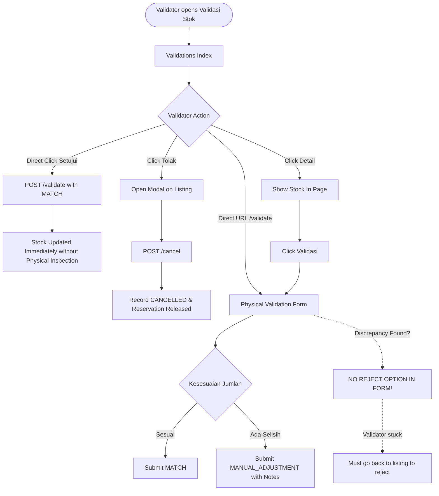
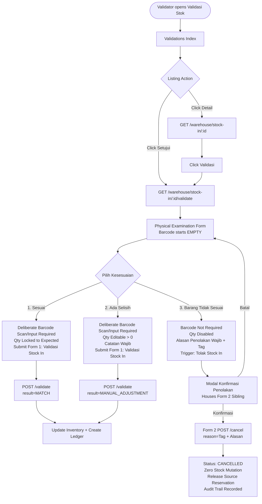
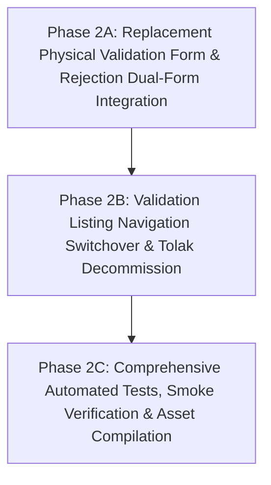

# Gate 1 — Warehouse Stock In Validation Revision Plan

- **Repository:** `poyipoy/fastware_adsi_1`
- **Module:** Warehouse Consumable (Stock In & Physical Validation)
- **Version:** `1.2.0-final`
- **Gate:** 1 (Repository Audit, Impact Analysis & Implementation Planning)
- **Status:** **PENDING USER APPROVAL**

---

## 1. Executive Summary

This document establishes the architectural audit, impact analysis, and implementation roadmap for revising the **Stock In Physical Validation** workflow in the Fastware ADSI application.

### Core Problems Addressed
1. **Flawed Approval Bypass in Listing:** The "Validasi Stok" index view (`resources/views/warehouse/validations/index.blade.php`) currently exposes a direct "Setujui" button that immediately commits incoming stock as `MATCH` via a POST form. This completely bypasses physical goods inspection and barcode scanning.
2. **Disconnected Rejection UI:** The "Tolak" action currently resides as a modal on the listing table. If a validator opens the detailed physical examination form (`resources/views/warehouse/stock-in/validate.blade.php`), they can only choose between "Sesuai" and "Ada Selisih / Input Manual". There is no option to reject the delivery from the physical inspection page if the wrong goods arrive or items are severely damaged.
3. **Missing Rejection Scenario on Physical Examination:** Goods arriving at the warehouse frequently fail physical inspection due to:
   - *Mismatched Item Identity:* The physical barcode or Item Code does not match the submitted record (e.g., expected Item A, received Item B).
   - *Unacceptable Physical Condition:* Received goods are broken, cracked, rusted, or otherwise unusable.
   The validator needs a dedicated, auditable "Barang Tidak Sesuai" decision that terminates the Stock In without creating inventory or ledger entries.
4. **Barcode Prefill Defect in Current Examination Form:** Currently, `stock-in/validate.blade.php` prefills the `received_item_barcode` input with the expected item's barcode. Opening the form does not prove that a physical scan occurred, allowing validators to rubber-stamp approvals without deliberate item verification.

### Key Architectural Decisions
- **Zero Database Migration:** The underlying database table `trs_wh_stock_ins` already provides all required columns (`status`, `cancellation_reason`, `cancelled_by_user_id`, `cancelled_at`, `cancellation_idempotency_key`). No schema changes are required.
- **Zero Enum Modification:** `WarehouseStockInStatus::CANCELLED` already represents the terminal cancelled/rejected lifecycle state. "Barang Tidak Sesuai" is an operational examination decision that cleanly invokes the existing cancellation domain service (`WarehouseStockInService::cancel`).
- **Separation of Terminal Actions via Non-Nested Dual Forms:** Physical acceptance (`VALIDATED` with stock increment) and physical rejection (`CANCELLED` with zero stock increment and reservation release) are completely isolated at the UI and backend layers into two distinct, non-nested HTML forms with independent CSRF tokens and independent UUID `name="idempotency_key"` tokens (strictly decoupled from underlying DB column names).
- **Strict Guarding Against Direct Approval:** The direct POST form on the listing is removed. "Setujui" becomes an anchor navigation link to the physical examination form, enforcing the rule that physical validation cannot be bypassed from the index view.
- **Preserved Backend API Compatibility & UI Barcode Enforcement:** To avoid breaking existing integration tests (e.g., in `WarehouseRevisionFourTest.php`), the backend `ValidateWarehouseStockInRequest` retains its flexible API contract (`sometimes, nullable`), while the Blade UI form strictly enforces deliberate item entry by loading with an empty barcode and requiring entry prior to acceptance.

---

## 2. Confirmed Requirements

### Revision A: Add "Barang Tidak Sesuai" to Stock In Physical Validation
- **Options Expanded:** Expand "Kesesuaian Pemeriksaan Fisik" from 2 options (`MATCH`, `MANUAL_ADJUSTMENT`) to 3 options:
  1. **Sesuai** (`MATCH`) — Physical goods match recorded item and quantity.
  2. **Ada Selisih / Input Manual** (`MANUAL_ADJUSTMENT`) — Physical item matches, but quantity differs.
  3. **Barang Tidak Sesuai** (`REJECT` / physical discrepancy) — Goods received do not match or are unacceptable.
- **Scope of "Barang Tidak Sesuai":**
  - *Mismatch in Item Identity:* Received barcode or Item Code does not match the submitted record (expected Item A, received Item B).
  - *Unacceptable Physical Condition:* Received goods are broken, cracked, rusted, or otherwise unusable.
- **UI Behavior:**
  - Selecting "Barang Tidak Sesuai" reveals a mandatory rejection reason textarea (`min:3, max:2000`) and structured reason category tags.
  - Hides/disables the normal "Validasi Stock In" submit button and exposes a distinct "Tolak Stock In" action (`btn-danger`).
  - Disables strict barcode matching and quantity acceptance requirements so rejection cannot be blocked by item mismatch errors.
  - Requires an explicit confirmation dialog/modal before committing rejection.
- **Domain Invariants:**
  - Must NOT increment destination stock.
  - Must NOT generate any stock ledger transactions (`trs_wh_stock_transactions`).
  - Must immediately release any active source reservations for internal location transfers.
  - Must record audit data: `cancelled_by_user_id`, `cancelled_at`, and `cancellation_reason`.

### Revision B: Relocate Rejection Action
- **Listing Clean-Up:** Completely remove the "Tolak" button and its associated modal (`#rejectModal-{{ $loop->index }}`) from `resources/views/warehouse/validations/index.blade.php`.
- **Form Co-Location:** The physical examination form (`resources/views/warehouse/stock-in/validate.blade.php`) becomes the single authoritative interface for rejecting a pending Stock In.
- **Contextual Availability:** Rejection is only unlocked when the validator explicitly chooses "Barang Tidak Sesuai".

### Revision C: Change Direct Approval Navigation
- **Navigation Only:** The "Setujui" button in `resources/views/warehouse/validations/index.blade.php` must NO LONGER execute a direct POST approval.
- **Route Target:** Clicking "Setujui" converts into an anchor link `<a href="{{ $record['validation_url'] }}">` navigating directly to `route('warehouse.stock-in.validate-form', $stockIn)`.
- **Preserved Actions:** The "Detail" button remains intact, pointing to `route('warehouse.stock-in.show', $stockIn)`.

---

## 3. Current Implementation Findings

### 3.1 Authoritative Codebase Verification
- **Live Implementation Directories:** `app/`, `resources/`, `routes/`, `tests/`, `database/`.
- **Staging / Legacy Directory Check (`warehouse-consumable/`):**
  - Confirmed via `warehouse-docs/WAREHOUSE-STRUCTURE-REFACTOR.md` (lines 50–52) and `CLAUDE.md` (lines 20–24) that `warehouse-consumable/` contains pre-refactor staging/deployment artifacts that are **NOT live** and must **NOT** be modified.
  - All proposed changes are strictly isolated to live application files.

### 3.2 Key File Locations & Current Responsibilities
| File Path | Current Role / Responsibility | Key Observations & Verified Code Details |
| :--- | :--- | :--- |
| `resources/views/warehouse/validations/index.blade.php` | Validation workspace table listing pending and validated records. | Lines 51–59 contain an inline form submitting directly to `approve_url` with hidden inputs (`quantity_received`, `validation_result=MATCH`). Lines 60–90 contain the "Tolak" button and rejection modal. |
| `resources/views/warehouse/stock-in/validate.blade.php` | Detailed physical examination form. | Line 47: `name="received_item_barcode"` is prefilled with `value="{{ old('received_item_barcode', $stockIn->consumable?->barcode ?: $stockIn->consumable?->item_code) }}"`. Line 48 only renders `MATCH` and `MANUAL_ADJUSTMENT`. Form always posts to `warehouse.stock-in.validate`. |
| `resources/views/warehouse/stock-in/show.blade.php` | Read-only audit view for Stock In records. | Lines 58–62 already support rendering cancellation audit information (`cancelled_by_user_id`, `cancelled_at`, `cancellation_reason`). |
| `resources/js/warehouse/stock-in.js` | Client-side form interactivity for Stock In. | Lines 51–81 synchronize `quantity` readonly state, difference calculation, and notes requirement between `MATCH` and `MANUAL_ADJUSTMENT`. Keydown on Enter attempts `verifyScan`, but submitting without scanning is allowed because input is prefilled. |
| `resources/css/warehouse/stock-in.css` | Styles for Stock In and validation views. | Line 26: `.warehouse-stock-in-result-options` uses a 2-column grid (`repeat(2, minmax(0, 1fr))`). Needs responsive 3-option support and danger styling. |
| `app/Http/Controllers/Warehouse/WarehouseStockValidationController.php` | Controller for `/warehouse/validations`. | Lines 58–62 construct `$record` array with `detail_url`, `validation_url`, `approve_url`, and `reject_url`. `validation_url` is already generated. |
| `app/Http/Controllers/Warehouse/WarehouseStockInController.php` | Controller for Stock In CRUD, validate, and cancel. | Line 77: `validateForm()`. Line 91: `validateStockIn()`. Line 135: `cancel()`. `cancel()` returns JSON `['data' => $this->payload($result)]` without top-level `idempotent_replay`. |
| `app/Services/Warehouse/WarehouseStockInService.php` | Business service managing Stock In domain rules. | Line 129: `validate()` enforces `$receivedId === $consumable_id` (throws 422 on mismatch) and delegates to `stockService->execute()`. Line 261: `cancel()` sets `status=CANCELLED`, stores reason/user/time, sets `_idempotent_replay` attribute, and releases reservation without ledger entry. |
| `app/Http/Requests/Warehouse/TransactionRequests.php` | Form Requests for warehouse operations. | `ValidateWarehouseStockInRequest` (lines 211–240) defines `'received_item_barcode' => ['sometimes', 'nullable', 'string', 'max:120']`. `CancelWarehouseStockInRequest` (lines 242–270) defines `'reason' => ['required', 'string', 'min:3', 'max:2000']`. |
| `app/Enums/Warehouse/WarehouseEnums.php` | Central backed enums for Warehouse domain. | Contains `WarehouseStockInStatus` (`WAITING_VALIDATION`, `VALIDATED`, `CANCELLED`) and `WarehouseStockInValidationResult` (`MATCH`, `MANUAL_ADJUSTMENT`). |
| `app/Models/Warehouse/WarehouseStockIn.php` | Eloquent model for `trs_wh_stock_ins`. | Defines scopes `waitingValidation()` and `reserving()`. Contains `canValidate()` and `canCancel()`. |
| `app/Services/Warehouse/WarehouseVerifierPolicy.php` | Authorization policy for verification and validation workspace. | Checks `canAccessValidationWorkspace()`: allows users with `hasFullModuleAccess` (e.g., `JESSICA PAUNE`) OR users belonging to an authorized department with active restricted verifier record (`scope='ALL'`). Does not restrict self-validation. |
| `app/Services/Warehouse/WarehouseAccessService.php` | Warehouse module role, position, and permission mapping. | Line 41: `hasFullModuleAccess` matches `JESSICA PAUNE`. Line 47: `hasDepartmentAccess` checks active position in configured departments. |

---

## 4. Current Workflow vs. Proposed Workflow

### 4.1 Current Workflow (As-Is)


### 4.2 Proposed Workflow (To-Be)


---

## 5. UI/UX Behavior Specification

### 5.1 Radio Group Layout (`resources/views/warehouse/stock-in/validate.blade.php`)
The fieldset `Kesesuaian Pemeriksaan Fisik` will feature three distinct card options:
1. **Sesuai (`MATCH`)**
   - Title: `Sesuai`
   - Description: `Barang fisik dan jumlah sama persis dengan yang diajukan.`
   - Visual: Standard blue selection outline (`var(--warehouse-focus)`).
2. **Ada Selisih / Input Manual (`MANUAL_ADJUSTMENT`)**
   - Title: `Ada Selisih / Input Manual`
   - Description: `Barang sesuai tetapi jumlah fisik berbeda dan perlu disesuaikan.`
   - Visual: Standard blue selection outline.
3. **Barang Tidak Sesuai (`REJECT`)**
   - Title: `Barang Tidak Sesuai`
   - Description: `Barang fisik berbeda, rusak, atau kondisi tidak dapat diterima.`
   - Visual: Danger tint on hover/active, red outline and border when checked (`#ef4444`, `rgba(239, 68, 68, 0.15)`).

### 5.2 Physical Barcode Verification, UI Safeguards & Residual API Risk
- **The Core Distinction & Absence of Hardware Attestation:** A web application receiving input from USB/Bluetooth handheld barcode scanners receives standard keyboard events (`input`, `keydown`). It is technically impossible in standard web applications to cryptographically attest that characters originated from an optical laser sensor rather than physical keyboard keystrokes. Therefore, we do **not** claim hardware scan authenticity.
- **Empty Barcode Input on Initial UI Render:** Currently, `validate.blade.php` line 47 automatically prefills the barcode input with `value="{{ old('received_item_barcode', $stockIn->consumable?->barcode ?: $stockIn->consumable?->item_code) }}"`. Because the field is prefilled, the validator never has to touch the scanner or verify the item; they can simply hit "Validasi". In this revision, the input is un-prefilled: `value="{{ old('received_item_barcode', '') }}"`. When the page loads, the input is strictly empty.
- **Mandatory Deliberate Barcode Entry for UI Acceptance:** On the browser UI, for acceptance options ("Sesuai" and "Ada Selisih"), the input carries the HTML5 `required` attribute and client-side form validation blocks submission if empty. The validator **must** actively scan or type the item code/barcode before acceptance can be submitted. Auto-focus is placed on the barcode field upon page load to optimize the scanner workflow.
- **Preserved Backend API Compatibility:** The backend FormRequest (`ValidateWarehouseStockInRequest`) retains `'received_item_barcode' => ['sometimes', 'nullable', 'string', 'max:120']`. We do **not** claim server-enforced barcode submission because the backend schema continues to permit an omitted barcode to avoid breaking existing automated tests and programmatic API integrations (e.g., in `WarehouseRevisionFourTest.php`).
- **Residual Direct API Approval Risk:** Because the backend permits omitted barcodes and falls back to the expected consumable ID when no barcode is supplied (`$receivedConsumableId ?: $stockIn->consumable_id`), an authenticated actor sending a raw HTTP POST directly to `/warehouse/stock-in/{stockIn}/validate` without `received_item_barcode` can approve the record without providing a barcode. This is an explicit, accepted trade-off to preserve backward compatibility across the repository's test suites, placing the deliberate-inspection guardrail squarely at the UI layer.

### 5.3 Responsive Grid Design
- **Desktop (>= 992px):** 3 equal columns (`grid-template-columns: repeat(3, minmax(0, 1fr))`).
- **Tablet (768px – 991px):** Auto-fit minmax (`grid-template-columns: repeat(auto-fit, minmax(220px, 1fr))`).
- **Mobile (< 768px):** Single column stack (`grid-template-columns: 1fr`). Minimum touch target height >= 48px (meets WCAG 2.2 SC 2.5.8 Target Size).

### 5.4 Form State Matrix
| State Item | Option 1: Sesuai | Option 2: Ada Selisih | Option 3: Barang Tidak Sesuai |
| :--- | :--- | :--- | :--- |
| **Scan Item Code Input** | Required (empty on load). Must match expected item. | Required (empty on load). Must match expected item. | **Optional / Bypassed.** Validator is rejecting; barcode mismatch must not trigger HTML5 validation errors. |
| **Qty Aktual Input** | Readonly. Locked to `quantity_expected`. | Editable (`number`, `step=min`). User enters actual count. | **Disabled / Greyed out.** Ignored during rejection. |
| **Selisih Indicator** | Displays `0`. | Computes `actual - expected`. | Displays `Ditolak (0 pcs masuk)`. |
| **Catatan Validasi** | Optional textarea. | **Mandatory** (`required`). | Hidden or disabled. |
| **Alasan Penolakan Wrap** | Hidden (`hidden`). | Hidden (`hidden`). | **Visible & Mandatory** (`required`, `minlength="3"`). |
| **Sub-Kategori Penolakan** | Hidden. | Hidden. | Radio tags: `Salah Barang` / `Barang Rusak` / `Lainnya`. |
| **Form 1 (Validasi) Button** | "Validasi Stock In" (`btn-primary`, visible). | "Validasi Stock In" (`btn-primary`, visible). | **Hidden.** |
| **Form 2 (Tolak) Trigger** | Hidden. | Hidden. | **Visible: "Tolak Stock In"** (`btn-danger`, opens modal). |
| **Confirmation Modal** | Standard form submit. | Standard form submit. | **Mandatory Rejection Modal** containing Form 2. |

### 5.5 Rejection Modal & Dual-Form Architecture Specification
To ensure strict HTML compliance and eliminate cross-contamination between validation and rejection:
- **NO NESTED FORMS:** HTML prohibits `<form>` inside `<form>`. Form 1 and Form 2 are implemented as clean sibling elements in the DOM.
- **Form 1 (`#warehouse-stock-in-validation-form`):**
  - Wraps the physical inspection inputs.
  - Method: `POST`, Action: `route('warehouse.stock-in.validate', $stockIn)`.
  - Hidden inputs: `@csrf`, `<input type="hidden" name="idempotency_key" value="{{ (string) Str::uuid() }}">`.
  - Radio options: `name="validation_result"` for `MATCH` / `MANUAL_ADJUSTMENT`. The third radio acts purely as a frontend UI state switch and is not submitted as an enum to the acceptance endpoint.
  - Submit button: `#submit-validation-btn` ("Validasi Stock In", `btn-primary`).
- **Form 2 (`#warehouse-stock-in-rejection-form`):**
  - Placed inside `#rejectionConfirmModal` as an independent sibling form in the DOM.
  - Method: `POST`, Action: `route('warehouse.stock-in.cancel', $stockIn)`.
  - Hidden inputs: `@csrf`, `<input type="hidden" name="idempotency_key" value="{{ (string) Str::uuid() }}">` (an independent UUID value generated separately from Form 1), `<input type="hidden" name="redirect_to" value="validations">`.
  - Hidden input `name="reason"`: automatically synced via JavaScript from the rejection textarea and selected category tag before modal submission.
  - Submit button inside modal: `Ya, Tolak Stock In` (`btn-danger`, type="submit").
- **CRITICAL FORM CONTRACT RULE:**
  Both Form 1 and Form 2 submit their idempotency token using the HTTP request parameter `name="idempotency_key"`. Do **NOT** confuse the HTTP request field name (`idempotency_key`) with the underlying database column names `validation_idempotency_key` and `cancellation_idempotency_key` on the `trs_wh_stock_ins` table. Both `ValidateWarehouseStockInRequest` and `CancelWarehouseStockInRequest` validate `'idempotency_key' => ['required', 'uuid']`, and the controller passes this value directly to the service methods.
- **Accessibility (WCAG 2.2 AA):**
  - Full tab order and visible focus rings (`2px solid var(--warehouse-focus)`).
  - Keyboard shortcut `Esc` closes the modal without submitting.
  - All interactive controls have min target size >= 48px.
  - Form validation errors rendered with `aria-describedby` and `aria-live="polite"`.

---

## 6. Backend Architecture and Data Flow

### 6.1 Two Decoupled Request Channels
```text
Browser UI (Form 1) -----> POST /warehouse/stock-in/{id}/validate -----> WarehouseStockInService::validate()
                                                                                |
                                                                                +--> Ledger Mutated (VALIDATED)

Browser Modal (Form 2) ---> POST /warehouse/stock-in/{id}/cancel ------> WarehouseStockInService::cancel()
                                                                                |
                                                                                +--> Zero Ledger, Release Reservation (CANCELLED)
```

### 6.2 Preserving Backend API Compatibility & Documenting Residual Direct API Risk
- In `ValidateWarehouseStockInRequest`:
  `'received_item_barcode' => ['sometimes', 'nullable', 'string', 'max:120']`
  `'quantity_received' => ['required', 'numeric', 'gt:0', 'decimal:0,3']`
  `'validation_result' => ['sometimes', 'nullable', Rule::in(['MATCH', 'MANUAL_ADJUSTMENT'])]`
  `'idempotency_key' => ['required', 'uuid']`
- **Why we DO NOT make `received_item_barcode` strictly required on the backend:**
  Existing automated feature tests (e.g., `WarehouseRevisionFourTest::test_restricted_validator_can_reject_stock_in_from_validation_workspace`, line 95) submit programmatic validation requests without barcode payloads. Changing the FormRequest rule to `required` would cause unexpected test regressions across legacy suites.
- **Where the safeguard is applied:**
  The safeguard against accidental approval is enforced on the **UI / Form layer (`validate.blade.php`)** by initializing the input empty and requiring deliberate user entry prior to acceptance.
- **Documented Residual Direct API Risk:**
  Because the backend validation rule remains `sometimes, nullable`, a client executing a direct raw API request (e.g., via Postman, curl, or automated test) without `received_item_barcode` will bypass barcode verification. The backend controller defaults to the expected consumable ID without verifying a barcode scan. This residual risk is accepted to preserve API compatibility, and does not compromise browser users who must interact through the UI form.

---

## 7. Existing Route, Controller, Service, and Enum Assessment

### 7.1 Endpoint & Controller Assessment
| Endpoint | Controller Method | Form Request | Assessment & Plan |
| :--- | :--- | :--- | :--- |
| `GET /warehouse/validations` | `WarehouseStockValidationController@index` | Checked via `WarehouseVerifierPolicy` | **Modify View Only:** Remove direct approve form and reject modal. Change "Setujui" button to `<a href="{{ $record['validation_url'] }}">`. |
| `GET /warehouse/stock-in/{stockIn}/validate` | `WarehouseStockInController@validateForm` | Route Model Binding + `WarehouseVerifierPolicy` | **Keep Intact:** Renders `validate.blade.php`. Already verified and authorized. |
| `POST /warehouse/stock-in/{stockIn}/validate` | `WarehouseStockInController@validateStockIn` | `ValidateWarehouseStockInRequest` | **Keep Intact:** Service enforces item match when barcode is provided. Existing API contract preserved. |
| `POST /warehouse/stock-in/{stockIn}/cancel` | `WarehouseStockInController@cancel` | `CancelWarehouseStockInRequest` | **Reuse Directly:** Accepts `reason`, `idempotency_key`, and `redirect_to`. Returns 200 JSON with `data` payload or redirects to listing. |

### 7.2 Cancellation Controller Response Contract
- Currently, `WarehouseStockInController@cancel()` returns:
  ```php
  if ($request->expectsJson()) {
      return response()->json(['data' => $this->payload($result)], 200);
  }
  ```
- Note that unlike `store()` and `validateStockIn()`, `cancel()` does not output a top-level `'idempotent_replay'` boolean in JSON. The service internally handles idempotent replays and sets the record attribute `_idempotent_replay = true`, but the controller response remains `['data' => ...]`.
- In Gate 2, the controller response can either expose `'idempotent_replay' => (bool) $result->getAttribute('_idempotent_replay')` alongside `'data'`, or tests will simply assert `data.status === 'CANCELLED'`. Both approaches are safe; exposing it provides consistency across all three mutation endpoints.

---

## 8. Status Transition Matrix

| Current Record State | Action Triggered | Target Endpoint | Resulting Status | Resulting Validation Result | Inventory Impact | Source Reservation Impact |
| :--- | :--- | :--- | :--- | :--- | :--- | :--- |
| `WAITING_VALIDATION` | Select "Sesuai" & Submit | `POST /validate` | `VALIDATED` | `MATCH` | **+Qty** to destination | Decremented / Committed |
| `WAITING_VALIDATION` | Select "Ada Selisih" & Submit | `POST /validate` | `VALIDATED` | `MANUAL_ADJUSTMENT` | **+Actual Qty** to destination | Decremented / Committed |
| `WAITING_VALIDATION` | Select "Barang Tidak Sesuai" & Confirm | `POST /cancel` | `CANCELLED` | `null` | **ZERO** change | **Released immediately** |
| `VALIDATED` | Attempt `/validate` | `POST /validate` | `409 Conflict` | Unchanged | ZERO change | None |
| `VALIDATED` | Attempt `/cancel` | `POST /cancel` | `409 Conflict` | Unchanged | ZERO change | None |
| `CANCELLED` | Attempt `/validate` | `POST /validate` | `409 Conflict` | Unchanged | ZERO change | None |
| `CANCELLED` | Attempt `/cancel` (Same Key) | `POST /cancel` | `CANCELLED` | Unchanged | ZERO change | None (Idempotent 200 Replay) |
| `CANCELLED` | Attempt `/cancel` (Different Key) | `POST /cancel` | `409 Conflict` | Unchanged | ZERO change | None (`canCancel()` fails) |

---

## 9. Inventory, Reservation, and Ledger Invariants

### 9.1 Invariant Rules
1. **Zero Stock on Rejection:** Under no circumstance may a rejected Stock In increment `current_stock`, `stock_ds8`, `stock_deltamas`, `stock_used_ds8`, or `stock_used_deltamas`.
2. **Zero Ledger Mutations:** `trs_wh_stock_transactions` must NOT receive any record when a Stock In is rejected.
3. **Reservation Release for Internal Transfers:**
   - When a transfer Stock In is created, `WarehouseStockReservationService` reserves `quantity_expected` at `source_location`.
   - The query scope `WarehouseStockIn::reserving()` specifically filters by `status = 'WAITING_VALIDATION'`.
   - When rejected, the status changes to `'CANCELLED'`. The record is immediately excluded from `reserving()`, freeing up the reserved quantity at the source location with zero manual balance adjustment needed.
4. **Negative Balance Protection:** Rejection releases source reservations, restoring available capacity, but never reduces physical stock.

---

## 10. Audit and Authorization Assessment

### 10.1 Verified Authorization Rules
- Based on direct inspection of `WarehouseVerifierPolicy.php` and `WarehouseAccessService.php`:
  1. **Full Module Access (`hasFullModuleAccess`):** Users identified with full module access (e.g., `JESSICA PAUNE`) can access the validation workspace, validate Stock In, and cancel Stock In without being in `mst_wh_restricted_verifiers`.
  2. **Restricted Verifiers:** Other users must have active departmental warehouse access (`hasDepartmentAccess`) **AND** must exist in `mst_wh_restricted_verifiers` with `scope = 'ALL'` and `is_active = true`.
  3. **Self-Validation Rules:** The codebase contains **NO** restriction prohibiting a user from validating or rejecting a Stock In that they created, provided the user holds valid validator privileges.

### 10.2 Rejection Audit Semantics & Categorization Strategy
- **Database Reality:** The database table `trs_wh_stock_ins` contains `cancellation_reason` (type `TEXT`) and `cancelled_by_user_id`. There is no dedicated `rejection_category` enum column.
- **Backward-Compatible Categorization via Standardized Prefixes:**
  To distinguish physical inspection rejections from administrative cancellations without schema migrations, the UI will prepend a standardized tag to the reason:
  - Wrong item identity: `[PENOLAKAN FISIK: SALAH BARANG] <Catatan rincian>`
  - Damaged / unacceptable goods: `[PENOLAKAN FISIK: BARANG RUSAK] <Catatan rincian>`
  - Other discrepancy: `[PENOLAKAN FISIK: LAINNYA] <Catatan rincian>`
  - Administrative cancellation (legacy): Plain text or `[PEMBATALAN ADMINISTRATIF] <Catatan>`
- **Limitations of Free-Text Classification:**
  Because reasons are stored in free-text `cancellation_reason`, SQL filtering relies on string pattern matching (`LIKE '[PENOLAKAN FISIK:%'`). If structured analytics or aggregated reporting is required in the future, a dedicated database column should be planned in a separate migration task. For Gate 1 & 2, this prefix convention fulfills all auditing requirements with zero schema disruption.

---

## 11. Idempotency and Concurrency Assessment

1. **Same-Key Replay & Observed Service Behavior (No Payload-Equivalence Check):**
   - Inspection of `WarehouseStockInService::cancel()` (lines 286–291) reveals the exact replay logic:
     ```php
     if ($record->status === WarehouseStockInStatus::CANCELLED
         && (string) $record->cancellation_idempotency_key === $key) {
         $record->setAttribute('_idempotent_replay', true);

         return $record->load(['consumable', 'creator']);
     }
     ```
   - **Crucial Architectural Finding:** Unlike `validate()` which executes `assertValidationReplay()` to verify payload equivalence, `cancel()` does **NOT** check whether the incoming reason or actor matches the original cancellation record.
   - **Behavioral Contract:** If a subsequent request reuses the same `idempotency_key` but provides a *different reason* or is submitted by a *different actor*, the service treats it strictly as an idempotent replay: it returns HTTP 200 with the existing record, sets `_idempotent_replay = true`, and **does NOT update** the existing `cancellation_reason`, `cancelled_by_user_id`, or `cancelled_at` in the database.
   - This prevents state corruption and preserves audit immutability. Test assertions must assert this actual behavior rather than falsely expecting a 422 or payload mismatch exception.

2. **Different-Key Repeat on Cancelled Record:**
   - If a Stock In is already `CANCELLED` and a cancellation request arrives with a *different* idempotency key, `$record->canCancel()` evaluates to `false`.
   - The service throws `WarehouseDomainException('Stock In yang sudah tervalidasi tidak dapat dibatalkan.', 409)` (record is in a terminal state and cannot be re-cancelled under a new transaction key).

3. **Approve vs Reject Race Condition:**
   - Both `validate()` and `cancel()` run inside `DB::transaction(..., 3)` and acquire a pessimistic row lock via `->lockForUpdate()`.
   - The winning transaction commits (`VALIDATED` or `CANCELLED`).
   - The losing transaction receives the lock second, fails either `canValidate()` or `canCancel()`, and is aborted cleanly with HTTP 409.

---

## 12. File-by-File Change Plan

| Exact File Path | Existing Responsibility | Proposed Modification | Reason | Risk | Associated Tests |
| :--- | :--- | :--- | :--- | :--- | :--- |
| `resources/views/warehouse/validations/index.blade.php` | Validation index view. | 1. Replace the direct approval `<form>` with `<a href="{{ $record['validation_url'] }}" class="btn btn-sm btn-success">Setujui</a>`.<br>2. Remove the "Tolak" button and `#rejectModal-{{ $loop->index }}`. | Enforce physical inspection navigation; relocate rejection to the form. | Low | `WarehouseUiContractTest` |
| `resources/views/warehouse/stock-in/validate.blade.php` | Physical examination Blade view. | 1. Remove barcode prefill (initialize `value="{{ old('received_item_barcode', '') }}"`).<br>2. Add third radio card "Barang Tidak Sesuai".<br>3. Add rejection reason textarea with category radio tags.<br>4. Add "Tolak Stock In" action button and confirmation modal.<br>5. Place Form 2 (`#warehouse-stock-in-rejection-form`) inside modal as a separate sibling form submitting `name="idempotency_key"`. | Prevent rubber-stamp validation; provide clean dual-form rejection UX without nested forms. | Medium | New `WarehouseStockInValidationRevisionTest` |
| `resources/js/warehouse/stock-in.js` | Validation form interaction script. | 1. Update `sync()` to handle 3 options.<br>2. When "Barang Tidak Sesuai" selected: set barcode `required = false`, disable quantity, show rejection wrap.<br>3. Sync reason and category prefix into Form 2 before modal submission.<br>4. Auto-focus empty barcode field on load for scanning. | Responsive, accessible, error-free interactive state transitions. | Medium | Frontend Vite build & browser verification |
| `resources/css/warehouse/stock-in.css` | Stylesheet for Stock In views. | 1. Update `.warehouse-stock-in-result-options` grid to 3 columns on desktop, 1 on mobile.<br>2. Add `.is-danger` styling for the third radio card.<br>3. Style the rejection reason container and modal. | Visual clarity, accessibility, and polished feel. | Low | Frontend Vite build |
| `app/Http/Controllers/Warehouse/WarehouseStockValidationController.php` | Controller for validation index. | Ensure `validation_url` is consistently provided in `$record` (already present, clean up references to `approve_url` / `reject_url`). | Maintain clean controller data contract. | Low | `WarehouseStockValidationControllerTest` |
| `app/Http/Controllers/Warehouse/WarehouseStockInController.php` | Controller for validate & cancel. | 1. Ensure `cancel()` redirects smoothly back to `warehouse.validations.index` when submitted from the validation form with `redirect_to=validations`.<br>2. Optionally expose `'idempotent_replay' => (bool) $result->getAttribute('_idempotent_replay')` in JSON response for consistency. | User workflow navigation and API consistency. | Low | `WarehouseStockInTest` |
| `tests/Feature/Warehouse/WarehouseStockInValidationRevisionTest.php` | **[NEW]** Feature test suite. | Create comprehensive test cases covering the 26 test requirements detailed in Section 15. | Verify all behavioral, security, accessibility, and invariant contracts. | Low | PHPUnit test runner |
| `tests/Feature/Warehouse/WarehouseUiContractTest.php` | UI contract assertions. | Update tests to assert that "Setujui" is an anchor link to the form and "Tolak" is absent from the listing. | Keep test suite synchronized with updated UI contracts. | Low | PHPUnit test runner |

---

## 13. Database Migration Assessment

- **Migration Required?** **NO.**
- **Verification Evidence:**
  Inspected migration `database/migrations/2026_08_20_000001_create_trs_wh_stock_ins_table.php`:
  ```php
  $table->string('status', 32);
  $table->uuid('cancellation_idempotency_key')->nullable()->unique();
  $table->text('cancellation_reason')->nullable();
  $table->foreignId('cancelled_by_user_id')->nullable()->constrained('users')->nullOnDelete();
  $table->timestamp('cancelled_at')->nullable();
  ```
  All required persistence fields already exist with proper indexes and foreign keys. Zero schema modifications are needed.

---

## 14. Risk Register and Mitigations

| Risk ID | Identified Risk | Likelihood | Impact | Architectural Mitigation |
| :--- | :--- | :--- | :--- | :--- |
| **R-01** | Validator bypasses physical item inspection because barcode was prefilled. | High | High | Remove barcode prefilling in `validate.blade.php`. Field loads empty and requires deliberate input/scan. |
| **R-02** | HTML form nesting causes browser form parsing bugs or cross-submission. | Medium | High | Form 1 (validation) and Form 2 (rejection) are strictly structured as non-nested sibling forms in the DOM. |
| **R-03** | HTML5 validation blocks rejection because scanned barcode does not match expected item. | Medium | Medium | In `stock-in.js`, selecting "Barang Tidak Sesuai" immediately sets `received_item_barcode.required = false` and clears any custom validity errors. |
| **R-04** | Breaking existing API tests by making barcode required on the backend request. | Medium | High | Maintain flexible backend `ValidateWarehouseStockInRequest` rules; enforce barcode entry on the Blade UI form layer. |
| **R-05** | Ambiguity between administrative cancellation and physical rejection in audit logs. | Medium | Low | UI prepends structured category prefixes (`[PENOLAKAN FISIK: SALAH BARANG]`, `[PENOLAKAN FISIK: BARANG RUSAK]`) to `cancellation_reason`. |
| **R-06** | Validator submits empty or whitespace rejection reason. | Medium | Low | Client-side `required` attribute + server-side `CancelWarehouseStockInRequest` enforcing `['required', 'string', 'min:3', 'max:2000']`. |
| **R-07** | Direct raw API requests bypass physical barcode validation because backend allows omitted barcode. | Low | Medium | Accepted backward-compatibility trade-off. Physical item verification is strictly guarded for end-users at the UI layer. Direct API requests require authenticated warehouse verifier privileges. |

---

## 15. Test Plan and Acceptance Criteria

### 15.1 Actionable Test Matrix (26 Core Scenarios)
| # | Test Scenario | Test Type | Target File | Expected Result |
| :--- | :--- | :--- | :--- | :--- |
| 1 | Third radio option "Barang Tidak Sesuai" is rendered in validation form | Feature / UI | `WarehouseStockInValidationRevisionTest` | View contains 3rd card with proper labeling. |
| 2 | Barcode input loads EMPTY on physical examination form | Feature / UI | `WarehouseStockInValidationRevisionTest` | `validate.blade.php` renders `received_item_barcode` with empty value (no prefill). |
| 3 | Existing options "Sesuai" and "Ada Selisih" retain their markup and behavior | Feature / UI | `WarehouseStockInValidationRevisionTest` | Selecting Sesuai locks qty; selecting Ada Selisih unlocks qty and requires notes. |
| 4 | Selecting "Barang Tidak Sesuai" reveals rejection reason and category tags | Feature / UI | `WarehouseStockInValidationRevisionTest` | DOM shows reason field & tags, hides validate button, shows reject button. |
| 5 | Rejection reason is mandatory on client and server | Feature / Validation | `WarehouseStockInValidationRevisionTest` | Submitting without reason fails client validation and server returns 422. |
| 6 | Whitespace-only rejection reason is rejected | Feature / Validation | `WarehouseStockInValidationRevisionTest` | Server rejects with 422 `Alasan pembatalan Stock In wajib diisi`. |
| 7 | Wrong item identity (different Item Code) can follow rejection flow | Feature / Domain | `WarehouseStockInValidationRevisionTest` | Rejection succeeds even if physical item does not match consumable ID. |
| 8 | Damaged item condition can follow rejection flow | Feature / Domain | `WarehouseStockInValidationRevisionTest` | Rejection succeeds with description of damage in reason. |
| 9 | Rejection produces ZERO stock ledger transactions | Feature / Invariant | `WarehouseStockInValidationRevisionTest` | `trs_wh_stock_transactions` table count remains unchanged (0 new rows). |
| 10 | Rejection does NOT increase destination stock | Feature / Invariant | `WarehouseStockInValidationRevisionTest` | Destination `stock_ds8` / `stock_deltamas` remains identical before and after. |
| 11 | Rejection immediately releases source reservations for internal transfers | Feature / Invariant | `WarehouseStockInValidationRevisionTest` | `WarehouseStockReservationService::reserved()` drops to 0.000 after rejection. |
| 12 | Successful matching quantities continue to work via form | Feature / Regression | `WarehouseStockInTest` | Submitting MATCH increments stock and sets status `VALIDATED`. |
| 13 | Successful manual adjustment continues to work via form | Feature / Regression | `WarehouseStockInTest` | Submitting MANUAL_ADJUSTMENT increments stock by actual qty and logs notes. |
| 14 | "Tolak" action and modal are absent from validation listing | Feature / UI | `WarehouseUiContractTest` | `validations.index` does not contain `data-bs-target="#rejectModal"` or Tolak button. |
| 15 | "Setujui" in listing navigates to physical examination form | Feature / UI | `WarehouseUiContractTest` | "Setujui" is an `<a>` tag with `href` pointing to `warehouse.stock-in.validate-form`. |
| 16 | Old direct-submit approval form is removed from listing | Feature / UI | `WarehouseUiContractTest` | `validations.index` does not contain inline POST form to `approve_url`. |
| 17 | Full module access user (e.g. Jessica Paune) can validate and reject | Feature / Security | `WarehouseStockInValidationRevisionTest` | Successfully validates and rejects without restricted verifier table record. |
| 18 | Restricted verifier with scope='ALL' can validate and reject | Feature / Security | `WarehouseStockInValidationRevisionTest` | Successfully validates and rejects. |
| 19 | Creator with validator privilege can validate their own Stock In | Feature / Security | `WarehouseStockInValidationRevisionTest` | Self-validation is permitted by policy. |
| 20 | Duplicate rejection submissions with identical reason are idempotent | Feature / Concurrency| `WarehouseStockInValidationRevisionTest` | Second POST with same UUID returns 200 with status CANCELLED and `_idempotent_replay = true`. |
| 21 | Same-key rejection replay with different reason or actor preserves original audit state | Feature / Concurrency| `WarehouseStockInValidationRevisionTest` | Second POST with same UUID but different reason/actor returns 200, leaves original reason and actor untouched in DB. |
| 22 | Cancellation request with different key on already CANCELLED record fails | Feature / Concurrency| `WarehouseStockInValidationRevisionTest` | Returns 409 Conflict; terminal status cannot be re-cancelled. |
| 23 | Concurrent approve and reject operations are mutually exclusive | Feature / Concurrency| `WarehouseStockInValidationRevisionTest` | Second operation gets 409 Conflict; no partial or corrupt state. |
| 24 | Cancellation/rejection audit trail is fully populated with structured prefix | Feature / Audit | `WarehouseStockInValidationRevisionTest` | `cancelled_by_user_id`, `cancelled_at`, and `cancellation_reason` with tag verified in DB. |
| 25 | Responsive layout and keyboard-accessibility contract | Feature / A11y | `WarehouseStockInValidationRevisionTest` | Desktop 3-column, mobile 1-column stack with touch target >= 48px; logical Tab sequence, barcode autofocus, Esc dismisses modal. |
| 26 | Existing API integrations and legacy test suites remain green | Regression | Full Warehouse Suite | All existing warehouse feature tests pass without regression. |

---

## 16. Implementation Phases for Gate 2

### 16.1 Atomic UI Delivery Principle
> [!IMPORTANT]
> **Atomic UI Delivery Rule:** All related validation and rejection UI changes must be delivered together. Never deploy removal of the listing rejection action before the replacement rejection workflow on the physical examination form is functional and verified! Both views and frontend assets must be released as a synchronized unit to prevent any window where validators cannot reject defective deliveries.



### Phase 2A: Replacement Physical Validation Form & Rejection Dual-Form Integration
1. Update `resources/views/warehouse/stock-in/validate.blade.php`:
   - Remove barcode prefill (initialize empty: `value="{{ old('received_item_barcode', '') }}"`).
   - Add third radio card: `Barang Tidak Sesuai`.
   - Add rejection reason textarea container with category radio tags.
   - Add "Tolak Stock In" trigger button (`btn-danger`).
   - Embed `#rejectionConfirmModal` containing Form 2 (`#warehouse-stock-in-rejection-form`) posting to `warehouse.stock-in.cancel` with `name="idempotency_key"`.
2. Update `resources/js/warehouse/stock-in.js`:
   - Add state synchronization for the 3rd radio option.
   - Handle toggling of barcode requirement, quantity disabling, rejection reason visibility, and modal trigger.
   - Auto-focus empty barcode field on page load for immediate scanner input.
3. Update `resources/css/warehouse/stock-in.css`:
   - Update grid layout for 3 columns on desktop (`>= 992px`) and 1 column on mobile (`< 768px`) with min touch target >= 48px.
   - Add danger styling for the 3rd radio card (`.is-danger:has(input:checked)`).
4. Verify controller `app/Http/Controllers/Warehouse/WarehouseStockInController.php`:
   - Ensure `cancel()` smoothly handles redirection back to `warehouse.validations.index` when submitted with `redirect_to=validations`.

### Phase 2B: Validation Listing Navigation Switchover & Tolak Decommission (Atomic Cutover)
1. Modify `resources/views/warehouse/validations/index.blade.php`:
   - Replace direct POST approval `<form>` with `<a href="{{ $record['validation_url'] }}" class="btn btn-sm btn-success">Setujui</a>`.
   - Remove listing "Tolak" button and modal `#rejectModal-{{ $loop->index }}`.
2. Update `app/Http/Controllers/Warehouse/WarehouseStockValidationController.php`:
   - Clean up unneeded `approve_url` and `reject_url` from `$record` data representation.
3. Update `tests/Feature/Warehouse/WarehouseUiContractTest.php` to assert the updated listing contract.

### Phase 2C: Comprehensive Automated Tests, Smoke Verification & Asset Compilation
1. Create new test suite: `tests/Feature/Warehouse/WarehouseStockInValidationRevisionTest.php` implementing all 26 scenarios.
2. Run targeted test suites:
   ```bash
   php artisan test tests/Feature/Warehouse/WarehouseStockInValidationRevisionTest.php
   php artisan test tests/Feature/Warehouse/WarehouseUiContractTest.php
   php artisan test tests/Feature/Warehouse/WarehouseStockInTest.php
   php artisan test tests/Feature/Warehouse/WarehouseRevisionFourTest.php
   ```
3. Execute manual smoke verification checklist before release:
   - [ ] **Step 1:** Open `/warehouse/validations`. Verify "Setujui" is an anchor link to `/warehouse/stock-in/{id}/validate`. Verify "Tolak" button is absent from listing.
   - [ ] **Step 2:** Open physical examination form. Verify `received_item_barcode` field loads strictly EMPTY and has auto-focus.
   - [ ] **Step 3:** Check responsive layout (desktop 3-column, mobile viewport < 768px single-column stack with touch target >= 48px).
   - [ ] **Step 4:** Verify keyboard accessibility (Tab sequence through cards and inputs; Space/Enter selection).
   - [ ] **Step 5:** Select "Barang Tidak Sesuai". Verify barcode requirement is bypassed and "Tolak Stock In" trigger appears.
   - [ ] **Step 6:** Click "Tolak Stock In". Verify modal opens. Press `Esc` key to verify modal dismisses without submitting.
   - [ ] **Step 7:** Fill rejection reason with category tag, submit modal. Verify redirection back to validations listing with status CANCELLED, zero inventory addition, and released reservation.
4. Compile frontend production assets:
   ```bash
   npm run build
   ```
5. Verify worktree cleanliness and report results.

---

## 17. Open Questions and Assumptions

### Confirmed Assumptions
- **Assumption 1:** `warehouse.stock-in.cancel` endpoint is the authoritative rejection handler and will be reused without creating parallel routes.
- **Assumption 2:** The existing `cancellation_reason` column in `trs_wh_stock_ins` is completely sufficient for recording reasons for mismatched or damaged goods when supplemented with standardized category prefix tags.
- **Assumption 3:** Stock In records in `WAITING_VALIDATION` that are rejected should transition to `CANCELLED`, exactly matching existing cancellation semantics.
- **Assumption 4:** Backend `ValidateWarehouseStockInRequest` keeps `received_item_barcode` as `sometimes, nullable` for backward API compatibility, while the Blade UI form strictly requires it.

### Open Questions for Review
- *None currently blocking.* All requirements, flows, authorization models, and data contracts have been fully verified against the live codebase.

---

## 18. Final Gate 1 Recommendation

The revised design satisfies all functional and non-functional requirements with **minimum necessary change**:
- It introduces zero database migrations.
- It introduces zero enum modifications.
- It reuses existing, battle-tested service methods (`WarehouseStockInService::cancel`).
- It closes the direct-approval loophole on the listing.
- It fixes the barcode prefill defect, guaranteeing deliberate physical inspection.
- It uses a non-nested dual-form architecture preventing accidental submission.
- It provides structured auditability via prefix tagging.

**GATE 1 REVIEW COMPLETE — AWAITING USER APPROVAL FOR GATE 2**
